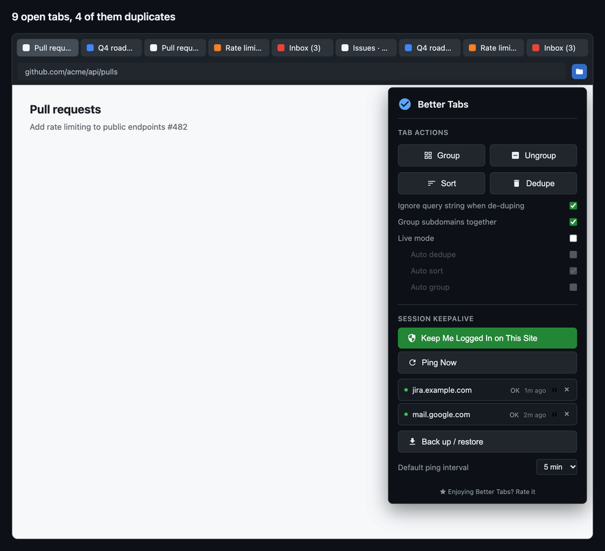

# Better Tabs

Manage browser tabs and keep site sessions alive.

[](https://addons.mozilla.org/firefox/addon/better-tabs1/)
[](https://addons.mozilla.org/firefox/addon/better-tabs1/)
[](https://addons.mozilla.org/firefox/addon/better-tabs1/reviews/)

<p align="center">
  
</p>

<p align="center">
  
</p>

## Features

- **Group** (Alt+Shift+G) - Group tabs by site
- **Sort** (Alt+Shift+S) - Order tabs by site and title
- **Dedupe** (Alt+Shift+D) - Close duplicate tabs, with Undo
- **Live Mode** - Sort, group and optionally dedupe automatically as you browse
- **Keepalive** - Stay logged in to chosen sites ([how it works](docs/how-it-works.md))
- **Logout Alerts** - Know when a site logs you out
- **Back up & Sync** - Site list syncs with your browser account and exports to JSON

## Install

**Firefox:** install from [Firefox Add-ons](https://addons.mozilla.org/en-US/firefox/addon/better-tabs1/). If it helps you, a [review](https://addons.mozilla.org/firefox/addon/better-tabs1/reviews/) helps others find it.

**Chrome** (148+, and other Chromium browsers): download `better-tabs-chrome.zip` from the [latest release](../../releases/latest), unzip it, open `chrome://extensions`, turn on **Developer mode**, click **Load unpacked** and select the unzipped folder.

### Local Development

Firefox:

1. Open `about:debugging#/runtime/this-firefox`
2. Click **Load Temporary Add-on**
3. Select `extension/manifest.json`

Chrome:

1. Run `npm run build:chrome` (writes `dist/chrome/` and `dist/better-tabs-chrome.zip`)
2. Open `chrome://extensions` and turn on **Developer mode**
3. Click **Load unpacked** and select `dist/chrome`

`extension/` holds the Firefox (Manifest V2) build. The Chrome build is generated from it as Manifest V3 with a service worker, so rebuild after every change.

## Tests

```bash
npm test
```
